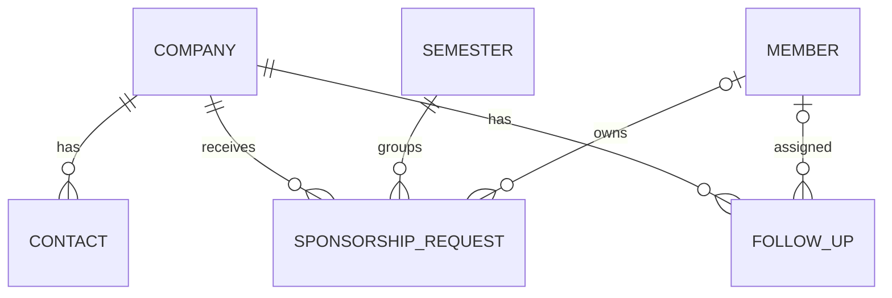

# Shared CRM schema

Owner: Mith. Contract based on the supplied project guide, PM assignment, repository main `a1ef153`, and Rishith's initial backend schema at `06c94db`.

## Relationships

A company is the durable relationship. Requests store semester-specific stage and amount. An officer may leave while the company's history remains. The scope is one organization's database; multiple clubs would require organization IDs and access isolation as a separate change.

## Common fields

All five CRM tables have `id uuid PRIMARY KEY DEFAULT gen_random_uuid()`, `created_at timestamptz NOT NULL DEFAULT now()` and `updated_at timestamptz NOT NULL DEFAULT now()`. Update triggers maintain `updated_at`. TypeScript represents UUIDs and ISO timestamps as strings, not as runtime-validated branded types.

## companies → Company

| Field | SQL type | Required / default | Meaning |
| --- | --- | --- | --- |
| name | text | Required, nonblank | Company/sponsor name |
| industry | text | Nullable | Industry/category |
| website | text | Nullable | Website URL |
| notes | text | Nullable, default empty string | Compatibility with existing schema |
| archived_at | timestamptz | Nullable | Archive without deleting history |
| created_by, updated_by | uuid | Nullable, references auth.users | Existing audit fields; application write behavior belongs to backend integration |
| contact_name, contact_email, contact_phone | text | Nullable, legacy | Preserved for the initial company form; new features use contacts |
| tier | text | Required, default unknown; legacy | Existing company-level tier; new requests have their own tier |
| status | text | Required, default prospect; legacy | Five pipeline values plus inactive; use request.stage for the real pipeline |

The migration preserves existing columns and policies. New company names cannot be blank. The nonblank check is added `NOT VALID` to preserve existing data; existing blank names need cleanup before validating the constraint across the entire table. Website/email format validation is a client/API concern not implemented by this schema.

## contacts → Contact

| Field | SQL type | Required / default | Meaning |
| --- | --- | --- | --- |
| company_id | uuid FK companies | Required | Parent company |
| name | text | Required, nonblank | Contact's name |
| title, email, phone | text | Nullable | Optional contact details |
| notes | text | Required, default empty string | Context for future officers |

One company can have multiple contacts. The migration copies any existing company contact into a contact row while preserving the original fields. These compatibility columns are not continuously synchronized: the team should read/write the contacts table for new features and later retire the old form fields.

## semesters → Semester

| Field | SQL type | Required / default | Meaning |
| --- | --- | --- | --- |
| name | text UNIQUE | Required, nonblank | Example: Spring 2026 |
| starts_on, ends_on | date | Required | Inclusive term boundaries |
| fundraising_goal | numeric(12,2) | Required, default 0, nonnegative | USD fundraising target |

End date must be on/after start date. Date-only values are `YYYY-MM-DD`; do not convert them through local/UTC midnight to display them. No overlapping-semester restriction is imposed: the team selects a semester explicitly.

## sponsorship_requests → SponsorshipRequest

| Field | SQL type | Required / default | Meaning |
| --- | --- | --- | --- |
| company_id | uuid FK companies | Required | Sponsor |
| semester_id | uuid FK semesters | Required | Fundraising term |
| owner_id | uuid FK profiles | Nullable | Assigned member |
| stage | pipeline_stage enum | Required, default prospect | prospect, contacted, in_talks, committed, received |
| amount | numeric(12,2) | Required, default 0, nonnegative | USD amount; zero means not yet known |
| tier | sponsor_tier enum | Required, default unknown | unknown, bronze, silver, gold, partner |
| notes | text | Required, default empty string | Request context |

Multiple requests per company per semester are allowed. If the product later needs exactly one, the team should first agree on how multiple proposals are represented. Numeric money is bounded below 10 billion and rejects PostgreSQL NaN; two fractional digits are stored. PostgreSQL rounds extra fractional digits, so a future API should reject excess precision if required.

## follow_ups → FollowUp

| Field | SQL type | Required / default | Meaning |
| --- | --- | --- | --- |
| company_id | uuid FK companies | Required | Related sponsor |
| assignee_id | uuid FK profiles | Nullable | Assigned member |
| task | text | Required, nonblank | Next action |
| due_on | date | Required | Due date |
| done | boolean | Required, default false | Completion state |
| completed_at | timestamptz | Nullable, database-managed | Set on completion, cleared on reopening |

A trigger keeps `done` and `completed_at` consistent. Repeating `done=true` preserves the original completion timestamp. This models storage behavior only; UI saving and permissions are not implemented in this handoff.

## profiles → Member (existing backend dependency)

Rishith's schema owns profiles and its authentication behavior. The shared Member type matches the inspected fields: `id`, `full_name`, `role` (admin/officer/member), `created_at`, `updated_at`. This migration does not create profiles, add approval fields, invite users, or change its policies. Membership verification is still Rishith's responsibility.

## Required input versus stored rows

Rows always include generated IDs/timestamps. `CompanyInsert` requires a name; `ContactInsert` requires company/name; `SemesterInsert` requires name/start/end; `SponsorshipRequestInsert` requires company/semester; `FollowUpInsert` requires company/task/due date. Other fields use defaults or accept null. Update types are partial insert types. The database—not TypeScript—enforces foreign keys, nullability and valid values at runtime. A string UUID/date still needs validation at the API boundary.

## Deletion and indexes

Company/contact/request/task links and semester/request links use `ON DELETE RESTRICT` to protect history. Deleting a member profile sets nullable request owner/task assignee links to null. Use company archiving for ordinary removal from active views. Existing company audit links to auth.users keep their original deletion behavior.

Indexes cover company contacts, company/semester request history, semester/stage totals, request owner, company tasks, open tasks by assignee/due date, and lowercase company name. These support the planned queries; no performance benchmark on production data is claimed.

## Planned derived metrics (not implemented here)

Received is the sum of received request amounts; awaiting is the sum of committed-stage amounts; the dashboard's committed headline combines received and awaiting; gap is max(goal − received − awaiting, 0). A renewal candidate is a prior received sponsor without a request in the selected semester. Rishith/Avinash will implement those queries. Avoid storing duplicate totals that can get out of sync.

## Access handoff

RLS is enabled on new tables and browser-role grants are revoked until Rishith defines access. Existing profiles/companies policies are preserved, including the known prototype rule allowing any signed-in user to read companies. Those existing policies are not proof of KTP membership and must be reviewed before real data is loaded. There are no auth setup scripts, seed data, dashboard RPCs or frontend integration in this deliverable.
